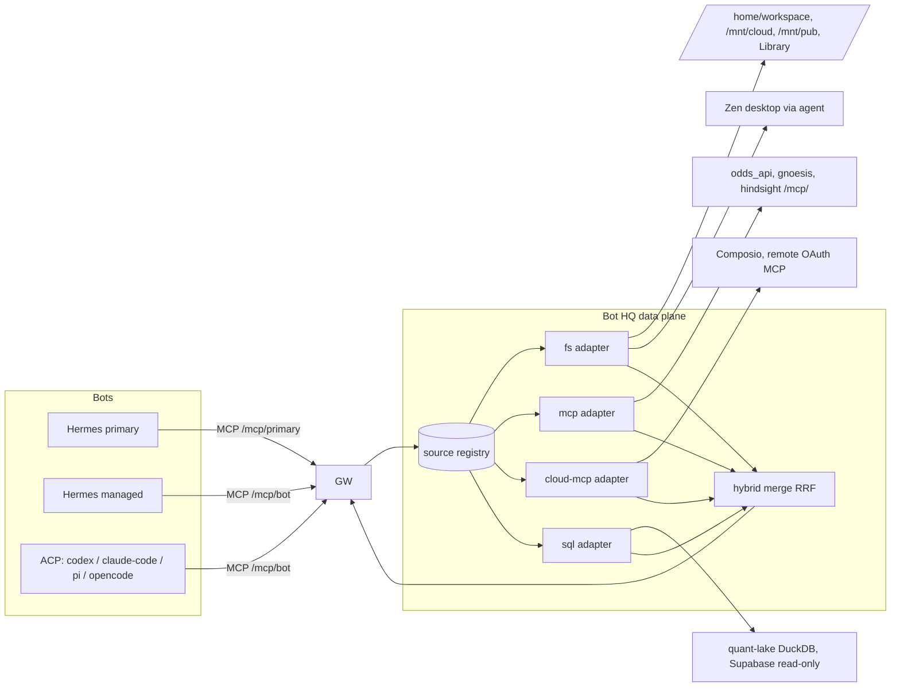

# Bot HQ data plane — design

Status: **phase 0 shipped 2026-11-15** (see §10); phases 1–4 proposed. Extends `ARCHITECTURE.md` §Data.

The question this answers: how do bots get data from local drives, local MCP servers, and cloud MCP, and how do Hindsight and the rest of the agentic data stack fit in without becoming a second system of record.

## 1. What exists today (measured, not assumed)

| Piece | State | Consequence |
|---|---|---|
| Bot → data | Bots run as root on this box, so a bot with a shell can already `cat` anything under `/home/workspace`, `/mnt/cloud`, `/mnt/pub` | Access is not the problem. Retrieval quality, scoping and audit are |
| Library | `/root/grokbot/files/<botId>`, flat, per bot. `save_file` writes; **no read/list/search tool exists** (18 tools in `agent/tools.ts`, none of them read a file) | Bots can write deliverables but cannot read them back through the app |
| MCP direction | Bot HQ is an MCP **server** to Hermes (`POST /mcp/<bot>`). Hermes is the client | The app has no MCP client of its own |
| External MCP | `mcp_servers` in `/root/.hermes/config.yaml`: `hq` + `odds_api` (stdio). `EXTRA_MCP_SERVERS` JSON env applies to **managed** bots only | Primary bot cannot get a new MCP server without editing a config the app is forbidden to write; ACP harnesses (codex, claude-code, pi, opencode) read none of it |
| Approvals | Cover Composio tools only (`policyFor` → `requestApproval`) | Any external MCP tool runs unapproved, unaudited, unscoped |
| Hindsight | Live on `127.0.0.1:8888`, 1 bank (`shared`), **9 facts**, 1 document. Read path works (recall 0.4 s). Write path **fails**: fact extraction returns `403 your subscription payment is past due` from Ollama Cloud via the Modal endpoint | The semantic index is empty and cannot grow until billing is fixed |
| Hindsight MCP | Serves a full MCP server at `http://127.0.0.1:8888/mcp/` (bank-pinned at `/mcp/<bank>/`) with ~40 tools: `retain`, `sync_retain`, `recall`, `reflect`, mental models, knowledge base, directives, documents, operations, tags, stats | No adapter needs to be written. It needs to be *filtered* |
| Gnoesis | Router on `127.0.0.1:7878`: `/memory/search|trace|record_outcome|reflect|propose_lesson|promote_lesson` + MCP tools. `policy.json` maps agent → allowed banks (`hermes: [shared, racewise]`) | Already the policy layer. Reuse it, do not duplicate it |
| quant-lake | `warehouse/quant.duckdb` 157 MB + Supabase Postgres, `raw_*` views | The only structured-analytics engine on the box |
| dsh-envopt | Catalog over the workspace: rank-1 answers in 0.5 s / ~140 tokens vs 24 s and 0/8 for `grep -rIin` | The cheapest way to answer "where is X" over 52 GB of files |
| Local drives | Box: 512 GB, 486 free. `/mnt/cloud`, `/mnt/pub` (9p). Desktop `Zen`: C: 29 GB free, G: 28 GB free | The desktop is a real source, but it is not mounted here |

## 2. The decision

**Bot HQ becomes the data-plane gateway. It does not become a config editor for five harnesses.**

Every alternative loses on a fact above:

- *Per-bot MCP config* — impossible for the primary engine (the app must never write its config), and duplicated five ways across ACP harnesses.
- *Give every bot the raw Hindsight MCP server* — 40 tools, including `delete_bank` and `clear_memories`, in every bot's tool list. Context bloat plus a footgun.
- *Let bots shell out to everything* — no scoping, no audit, no freshness, and ACP harnesses may have no shell.

So: one MCP surface (`/mcp/<bot>`, already built), one new toolset (`data`), and a **source registry** in `grokbot.db`. Adding a source is a row, not a config edit and not a restart.



## 3. The contract

Six tools, added to `TOOLS` in `agent/tools.ts` and therefore served to every harness through the existing endpoint. Nothing else changes for the bots.

| Tool | Signature | Notes |
|---|---|---|
| `data_list` | `(uri, depth=1)` | Directory or source listing. Returns names, sizes, mtimes, `uri` |
| `data_read` | `(uri, start?, end?, max_tokens=8000)` | Exact bytes or line range. Truncates with an explicit `truncated: true` and the next offset |
| `data_grep` | `(pattern, uri, glob?, max_hits=50)` | ripgrep over an allowlisted root. Returns `path:line:text` |
| `data_search` | `(query, sources?, k=8)` | Hybrid retrieval, fanned out and merged (see §5) |
| `data_ingest` | `(uri, bank, tags?)` | Push into Hindsight. Idempotent on content hash |
| `data_sql` | `(source, query, max_rows=200)` | Read-only, row-capped, statement-timeout |

URI scheme — one namespace over four transports, so a bot never has to know which one it is talking to:

```
fs://workspace/Projects/ornn-sme/README.md
fs://cloud/...            fs://pub/...        fs://library/<botId>/report.md
fs://zen/G:/data/...      (desktop, via the device agent)
mcp://odds_api/tool_name  mcp://hindsight/recall
cloud://composio/gmail_send_email
sql://quant-lake/select ...
```

Every result carries the same envelope, which is what makes provenance and freshness possible:

```json
{ "uri": "...", "source": "fs|mcp|cloud|sql", "bytes": 1234,
  "mtime": "2026-11-15T18:00:00Z", "hash": "sha256:...",
  "stale_seconds": 0, "truncated": false, "content": "..." }
```

## 4. Transports

**`fs` — local drives.** Allowlisted roots only, resolved with `realpath` before the prefix check (the pattern already in `routes-config.ts` for `/files/raw`; reuse it, do not re-derive it). Read-only by default. Writes stay in the Library. The desktop `Zen` is reached through the existing device channel, not a mount — a 9p mount of a Windows drive over the internet is a latency and correctness trap, and the device agent already exists.

**`mcp` — local MCP servers.** Bot HQ spawns and supervises stdio servers itself (the same shape as `/etc/zo/mcpo`, which already fronts `cloudflare`), and proxies HTTP ones. Per-source tool allowlist, per-bot grant, and every call goes through `policyFor`/`requestApproval` — the same gate Composio uses, so approvals stop being a Composio-only feature. `odds_api` moves out of `config.yaml` into the registry; `hindsight` and `gnoesis` register as HTTP sources.

**`cloud-mcp` — remote MCP.** Composio stays the default (1000+ apps, OAuth already solved, approvals already wired). Remote OAuth MCP servers are the same adapter with a different auth mode. Do not build a second OAuth flow.

**`sql` — structured.** Read-only role, `max_rows`, statement timeout, and a per-source column allowlist for anything with PII. `quant-lake` first, because it is the only place with real tables.

## 5. Retrieval: fan out, merge, cite

`data_search` is the tool that decides whether this design is good. It queries the engines that are already best at their job and merges with reciprocal rank fusion:

| Engine | Answers | Cost |
|---|---|---|
| Hindsight `knowledge-base/search` + `recall` | "what do we know about X" over ingested documents and facts | local embeddings, ~0.4 s |
| dsh-envopt catalog | "where in the workspace is X" over 52 GB of code and notes | 0.5 s, ~140 tokens |
| DuckDB FTS / `raw_*` views | "what do the numbers say" over tables | ms |
| `data_grep` | exact strings, when the query is a literal | ms |

RRF over the four, top-k, each hit carrying its `uri` so the bot can `data_read` the winner. This is the whole "optimized data engine" argument: no single index wins, and the merge is cheap because each engine returns a ranked list.

## 6. Hindsight topology

Hindsight is the **semantic index**, not the system of record. Raw bytes stay where they are; Hindsight holds derived facts, entities and embeddings.

- **Banks:** one per bot (`bot-<id>`) plus `shared`. Banks are a `PUT` and cost nothing; `shared` currently holds 9 facts, so this is the moment to set the topology before there is anything to migrate. Gnoesis `policy.json` already expresses agent → bank grants — extend it rather than inventing a second ACL.
- **Ingest is idempotent and replayable:** `document_id` = content hash, `operation_id` = `sha256(uri + hash)` so a retry after a timeout cannot double-write (the API returns 409 on a reused id belonging to a different operation, which is the correct failure).
- **Degrade, don't fail:** observed today — `file_convert_retain` completed while `retain` failed. Chunking and embeddings are local; only fact extraction needs the LLM. So when extraction is down, keep the document and serve it through knowledge-base search. A bot should get "here is the chunk, unconsolidated" rather than "no results".
- **Use the right primitive:** `mental-models` for standing briefs ("what this bot knows about the NFL ledger"), `directives` for standing instructions, `entities/graph` for the knowledge graph, `webhooks` to notify Bot HQ when an ingest finishes. Do not re-implement any of these in SQLite.
- **Tool filtering:** pin a bank per bot and enable a subset of the ~40 MCP tools. `delete_bank`, `clear_memories`, `delete_document` are not bot tools.

## 7. Blockers

1. **Hindsight write path is dead.** `403 your subscription payment is past due` from Ollama Cloud, reached through `https://jeffgus--llm-endpoint-api.us-east.modal.run/v1`. The Modal endpoint is up; the upstream account is not. This is a billing fix, not code, and it blocks every ingest path. Until it is fixed, Phase 2 runs in chunk-only mode.
2. **Hosted-service slots are full** (Basic cap 5). Bot HQ is supervisord-only, so `https://bot-hq-herb.zocomputer.io` 404s and the Zo browser cannot reach it. The data plane does not need a public hostname, but the UI does.
3. **`COMPOSIO_API_KEY` shape** (`ak_…`) does not match Composio's project-key format. Verify before the cloud-mcp leg depends on it.

## 8. Phases

| Phase | Scope | Acceptance test |
|---|---|---|
| 0 | `data` toolset, `fs` transport only, allowlisted roots, `data_list/read/grep/search` over the dsh-envopt catalog | A bot answers "what did we decide about the ORNN model bias" with a `uri` and a quoted line, in one turn, on all five harnesses |
| 1 | Source registry table + `mcp` transport + approvals for MCP tools; migrate `odds_api` | `odds_api` removed from `config.yaml`, still callable, and a write-shaped MCP tool produces an approval card |
| 2 | Hindsight ingest worker, per-bot banks, KB search in `data_search` | Ingest 50 workspace docs, recall a fact from one of them, re-run the ingest and confirm 0 new documents |
| 3 | `sql` transport on quant-lake | `data_sql` returns a row-capped result and refuses a write statement |
| 4 | `cloud-mcp` unified with Composio approvals, per-bot scopes | A remote MCP tool call is denied for a bot without the grant |

## 9. How we know it works

A 20-question eval set per source (10 answerable, 10 not), scored on: correct `uri` in the top 3, tokens spent, p50/p95 latency, and whether the bot said "I don't know" on the unanswerable half. Baseline is today's behavior — shell + `grep`, which is 24 s and 0/8 on the dsh-envopt benchmark. Track it in `experiments/data-plane.jsonl` and re-run on every phase. A phase that does not move top-3 accuracy or tokens is not done.

## 10. Phase 0 — what shipped (2026-11-15)

Code: `server/src/dataplane/fs.ts` (not `src/data/`: the repo ignores `data/` to keep `grokbot.db` out). Tools are appended to `TOOLS` in `server/src/agent/tools.ts` as `DATA_TOOLS`, so every engine gets them over `/mcp/<bot>`. Tests: `npm test -w server` (8, node:test via tsx). Live probe: `node --env-file=../.env scripts/data-probe.mjs "<query>"` from `server/`. Results log: `experiments/data-plane.jsonl`.

| Tool | Behavior as built |
|---|---|
| `data_search` | RRF (K=60) over three engines: catalog `docs_fts` (bm25 title 2.0 / path 1.5 / summary 1.0), catalog `file_fts` (path names, text-like extensions), and a live scan of the calling bot's Library. Near-duplicate trees collapsed. Each hit gets live `mtime`/`bytes` and `stale_seconds` = how long after the catalog build the file changed. 0.25–0.54 s warm; the catalog handle is cached and warmed 2 s after boot (cold first query was 6.4 s on 9p) |
| `data_read` | Line range + `max_tokens` budget, `truncated` + `next_start`, sha256 `hash`, binary detection, 20 MB ceiling |
| `data_list` | Depth 1–4, skips `node_modules`/`.git`/`dist`/`target`/venvs/`Trash`; no uri → roots |
| `data_grep` | ripgrep `--json`, `--no-ignore-vcs --no-ignore-parent` (the workspace `.gitignore` is `*`, which otherwise hides everything), smart case, 2 MB file cap, 20 s timeout with `timed_out`. Grepping the bare `fs://workspace/` or `fs://cloud/` root is refused — measured 84 s over 9p |

Roots: `fs://workspace`, `fs://cloud`, `fs://pub`, `fs://library` (override with `DATA_ROOTS=name=/path,...`; catalog with `DATA_CATALOG`). Paths are realpath-resolved before the prefix check (symlink escape refused). Credentials are withheld by path pattern: any `*.env` / `.env*`, `*.pem|key|p12|pfx|kdbx`, `*.token|pass|secret`, `id_*` keys, `auth.json`, `endpoint_key`, `credentials*`, `*secret*.{json,yaml,env,txt}`, `.git/`, `Trash/`. The first version missed `.picks.env` (pattern only matched a bare `.env`); a regression test now covers it.

**Acceptance (managed Hermes, bot Sam): pass.** One turn, 17.1 s: `data_search` → `data_read` → answer citing `fs://workspace/Projects/ornn-sme/README.md` with a verbatim line (verified at README.md:226).

**Open items**

1. **Primary engine (Thoth) does not see the tools yet.** The Hermes gateway caches the MCP tool list at startup; `/reload-mcp` exists but is not reachable through `/v1/responses`, and the app is barred from restarting the primary gateway. Fix: send `/reload-mcp` to Hermes from a messaging channel or the TUI, or restart the gateway once.
2. **ACP harnesses untested** — no bot currently runs codex / claude-code / pi / opencode. They read the same `/mcp/<bot>` list per turn, so they should work without a restart, but that is unverified.
3. **Catalog freshness.** The catalog was 4 days stale (built before `ornn-sme` existed) and had to be rebuilt (`bench/build_catalog.py`, 83 s). Search only finds what the catalog has; a nightly rebuild is needed before this is dependable.
4. The 20-question eval set (§9) is not built yet; phase 0 was validated on one question.
